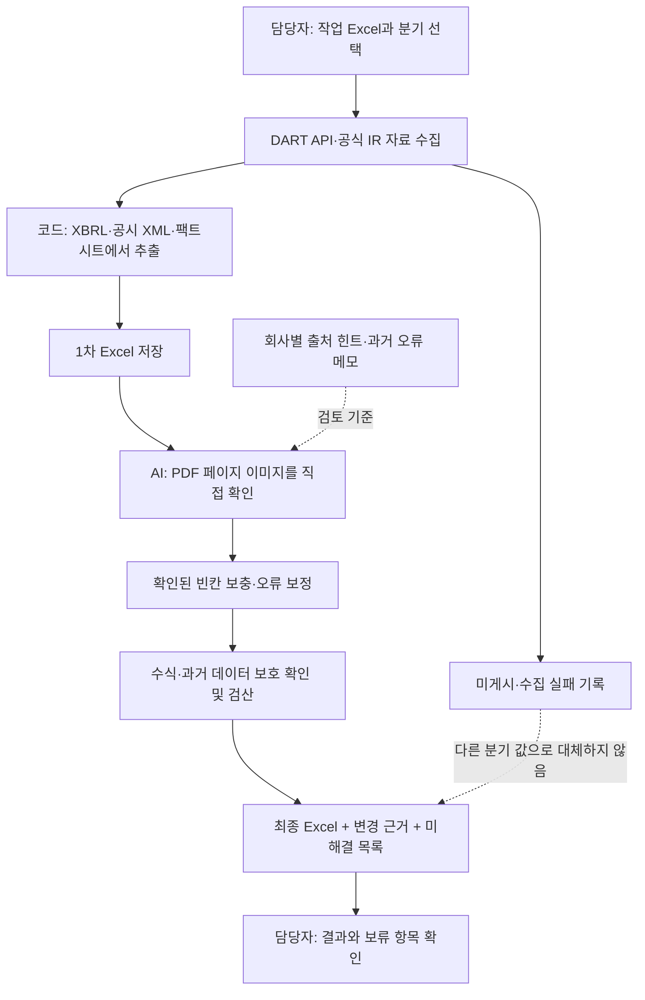

# 보험사 분기 공시 → Excel 입력

12개 보험사의 분기 공시를 모아 기존 Excel 양식에 입력하는 프로그램입니다.
**코드가 1차로 채우고, AI가 PDF 페이지를 읽어 빈칸을 보충하거나 입증된 오류를 고칩니다.**
이 README가 있는 폴더가 실행 폴더입니다. AI에게는 이 폴더를 로컬 프로젝트로 등록하면 됩니다.

## 한눈에 보는 흐름



| 누가 | 하는 일 |
|---|---|
| 담당자 | 사용할 Excel과 분기를 정하고 결과·보류 항목 확인 |
| 코드 | 공식 자료 수집, 숫자 추출, 단위 환산, Excel 입력, 보호·검산 |
| AI | 실제 PDF의 회사·표·기간·단위·회계 기준을 확인하고 보정 근거 작성 |

PDF와 숫자가 다르다고 바로 바꾸지는 않습니다. 같은 항목의 정밀값은 유지하고,
단위·부호·기간·계정 매핑·추출 오류가 확인됐을 때 수정합니다.

## 처음 받는 담당자: 한 번만 준비

1. 전달받은 압축파일을 풀거나 저장소를 내려받습니다. 공유 링크만 열어 두지 말고 파일을 PC에 준비합니다.
2. **Windows + Python 3.10 이상**을 준비하고 `처음설정.cmd`를 실행합니다. 필요한 Python 패키지와 `.env` 예시를 준비합니다.
3. `.env`를 메모장으로 열어 부서에서 사용할 DART 인증키를 저장합니다.

   ```dotenv
   DART_API_KEY=발급받은_인증키
   ```

4. 본인 계정으로 AI 데스크톱 앱에 로그인하고 **이 폴더를 로컬 프로젝트로 등록**합니다. 로컬 파일 읽기·명령 실행·PDF 이미지 확인이 가능한 환경이어야 합니다.
5. 작업 Excel의 위치를 지정합니다. 새 파일을 주거나 기존 설정의 경로를 바꾸면 됩니다.

계정·대화 공유와 PC의 폴더 접근은 별개입니다. 웹 ChatGPT 프로젝트에 문서만 올리는 것으로는
이 로컬 프로그램의 실행 환경까지 만들어지지 않습니다.
[프로젝트와 로컬 폴더에 관한 공식 안내](https://learn.chatgpt.com/docs/projects)

**개인 API 키·로그인 정보가 있는 `.env`, 개인 경로가 있는 `quarterly.local.json`, `.venv`는 그대로 넘기지 않습니다.**
아래 전달용 압축파일 생성 도구는 이 파일들을 제외합니다. 받는 PC에서 새로 설정합니다.

## 매 분기 사용하는 방법

### 방법 A: 이 폴더를 등록한 AI에게 요청

아래 문장을 복사해 사용합니다. 분기와 첨부 Excel만 바꾸면 됩니다.

> README.md와 AGENTS.md를 읽고, 이 Excel에 2026년 9월 데이터를 채워줘.
> docs의 회사별 출처 힌트와 과거 오류 메모를 참고해 코드 1차 입력부터
> PDF 이미지 직접 검토·보정·검산·최종 저장까지 진행해줘.
> 기존 기간과 수식은 보존하고, 미확인 항목은 추정하지 말고 목록으로 알려줘.

담당자가 검토용 JSON을 만들거나 명령을 따로 이어서 실행할 필요는 없습니다.
AI는 아래 assistant 경로로 시작하고 PDF 검토와 최종 저장까지 이어서 수행합니다.

### 방법 B: 분기 선택 화면 실행

`분기입력.cmd`를 열어 **연도·분기·작업 Excel**을 고르고 실행합니다.
이 방법의 PDF 검토에는 **Codex CLI 설치와 본인 계정 로그인**이 추가로 필요합니다.
CLI 설치·로그인은 초기 설정 담당자가 지원하면 됩니다.
[Codex CLI 공식 안내](https://learn.chatgpt.com/docs/codex/cli) · [로그인 안내](https://learn.chatgpt.com/docs/auth)

최종 Excel이 만들어져도 미확인 항목이 남을 수 있으므로 종료 메시지와 결과 목록을 확인합니다.

## 결과는 어디에 있나

원본을 덮어쓰지 않고 `runs/분기/실행ID/`에 저장합니다.

| 파일 | 확인할 내용 |
|---|---|
| `final.xlsx` | PDF 검토·보정을 반영한 결과 Excel |
| `summary.md` / `summary.json` | 입력·검토·수정 수, 검산과 재계산 상태 |
| `unresolved.csv` | 아직 못 찾은 값, 기준 충돌, 검토하지 못한 항목 |
| `changes.json` | 수정 전후값과 PDF 페이지·사유 |
| `stage1.xlsx` | 코드가 채운 1차 결과 |
| `collection_issues.json` | 공시 미게시·다운로드 실패 등 수집 문제 |

`completed_with_unresolved`는 최종 파일은 저장됐지만 확인할 항목이 남았다는 뜻입니다.
`pending_excel_recalculation`이면 수식 재계산이 남았습니다. LibreOffice가 있으면 자동 재계산하고,
Windows Excel에서는 아래 개발 명령으로 실행 사본만 재계산할 수 있습니다.

## 과거에 정리한 힌트는 어디에 있나

**아래 세 JSON은 다음 PDF 검토 프롬프트에 전달됩니다. 과거 정답 숫자를 입력값으로 재사용하는 파일이 아닙니다.**

| 파일 | 내용 |
|---|---|
| [quarterly_lessons.json](docs/quarterly_lessons.json) | 누계·잠정/최종·연결/별도·부호 등 과거 실수와 재발 방지 기준 |
| [review_navigation_2025.json](docs/review_navigation_2025.json) | 직접 읽었던 회사·칼럼별 PDF 표·행·열·단위·페이지 예시 |
| [company_field_sources.json](docs/company_field_sources.json) | 회사별 출처, 팩트시트 위치, 항목 해석 안내 |

사람이 읽을 때는 [회사별 출처 안내](docs/회사별_칼럼별_출처안내.md),
[오류 원인 메모](docs/2025_오류원인메모.md), [2025년 검증 현황](docs/2025_검증현황.md)을 봅니다.
AI가 새 대화에서 지켜야 할 실행 지침은 [AGENTS.md](AGENTS.md),
2609 작업 절차는 [2609 실행 지침](docs/2609_실행지침.md)에 있습니다.
과거 페이지 번호·표 구조는 힌트이며 현재 분기의 원문에서 다시 확인합니다.

## 입력과 보호 기준

- FISIS는 사용자 요청으로 제외했습니다. `use_fisis=false`를 유지합니다.
- `DATA_작업_빈칸_2512backup.xlsx`는 정답 기준입니다. 작업 양식으로 사용하지 않습니다.
- 일반 실행에서는 2512까지 보호하고, 선택 분기 이전의 기존 데이터도 보호합니다.
- CALC·CHECK 셀을 채우지 않으며 기존 수식과 과거 기간을 보존합니다.
- 미게시·미확인 값은 빈칸/미해결로 남깁니다. 다른 분기 값이나 역산값으로 대신하지 않습니다.
- 범위·발표 시점이 다른 값은 충돌로 보류합니다. 반올림값으로 기존 정밀값을 덮지 않습니다.

## 설정·명령어: 설정 담당자용

설정 우선순위는 **명령줄 `--workbook` → `quarterly.local.json` → `quarterly.json`**입니다.
개인 경로는 `quarterly.local.json`에 저장합니다.

```json
{"workbook":"C:/업무/작업양식.xlsx","use_fisis":false}
```

```powershell
# 현재 대화의 AI가 직접 PDF 검토를 이어서 수행
.venv\Scripts\python.exe quarter_pipeline.py --period 2609 --reviewer assistant

# 다른 Excel 지정
.venv\Scripts\python.exe quarter_pipeline.py --period 2609 --reviewer assistant --workbook "C:/업무/작업양식.xlsx"

# Codex CLI가 PDF 검토까지 실행
.venv\Scripts\python.exe quarter_pipeline.py --period 2609

# 중단된 CLI 검토 재개 / 현재 AI가 작성한 검토 결과 반영
.venv\Scripts\python.exe quarter_pipeline.py --resume "runs/2609/실행ID"
.venv\Scripts\python.exe quarter_pipeline.py --finalize "runs/2609/실행ID"

# Windows Excel로 실행 사본 재계산
powershell -NoProfile -File recalculate_excel.ps1 -Path "runs/2609/실행ID/final.xlsx"

# 정답본 대조는 읽기 전용 / 자동 테스트
.venv\Scripts\python.exe quarter_pipeline.py --check-baseline --period 2512
.venv\Scripts\python.exe -m pip install -r requirements-dev.txt
.venv\Scripts\python.exe -m pytest tests -q
```

**`--reviewer assistant` 명령만으로는 완료되지 않습니다.** 자료 수집·1차 입력·검토 준비 후
현재 AI가 PDF 이미지를 확인하고 `--finalize`까지 수행해야 합니다.
공식 사이트 수집 실패 시에는 AI/운영 담당자의 추가 확인이 필요할 수 있습니다.

## 폴더 전달과 유지보수

전달용 묶음을 만들려면 아래 명령을 사용합니다. 코드·지침·작업 양식·정답본을 묶고,
개인 키·개인 경로·로그인·가상환경·과거 실행 로그는 제외합니다. 원본 파일은 수정하지 않습니다.

```powershell
.venv\Scripts\python.exe tools/export_handoff.py
```

공유 폴더에는 코드뿐 아니라 **실제로 사용할 작업 Excel과 정답본**도 있어야 합니다.
GitHub에 전달하려면 이 로컬 변경을 별도로 커밋·업로드해야 합니다. 폴더 정리만으로 원격 저장소가 갱신되지는 않습니다.

| 경로 | 역할 |
|---|---|
| `quarter_pipeline.py`, `quarterly/` | 실제 분기 수집·입력·PDF 검토·최종 저장 |
| `dart_api.py`, `parse_annual.py`, `ir_parse.py`, `ir_pdf.py` | 수집·추출 규칙 |
| `quarter_picker.py`, `분기입력.cmd`, `처음설정.cmd` | 담당자용 실행·초기 설정 |
| `docs/` | 출처 힌트·오류 메모·검증 현황 |
| `tools/`, `backtest_2512.py`, `tests/` | 개발·검증·인수인계 도구 |
| `data/` | 받은 공시 자료 |
| `runs/` | 실행 결과·원문 사본·검증 근거·정리 파일의 복구용 사본, Git 제외 |

과거 분기 재현 검증은 실제 정답본을 수정하지 않고 별도 사본에서 수행합니다.
검증 결과를 확정한 뒤 채점하며, 기준 차이·미해결 원인은 그대로 기록합니다.
