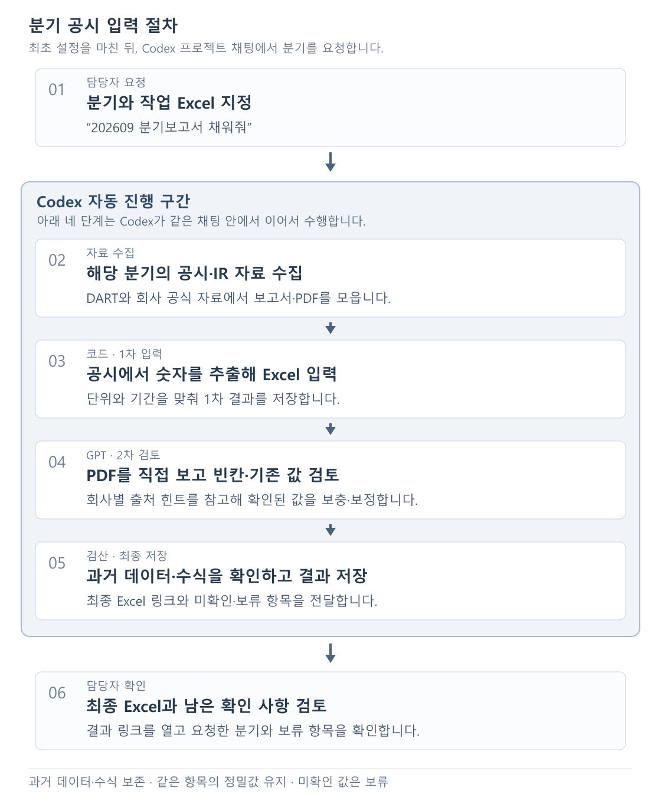

# 보험사 분기 공시 → Excel 입력

12개 보험사의 공시 자료를 모아 기존 Excel 양식을 채웁니다.
**담당자는 Codex 채팅으로 요청하고, GPT가 자료 수집부터 PDF 검토·최종 저장까지 진행합니다.**
코딩이나 명령어 입력은 필요하지 않습니다.

## 한눈에 보는 흐름

## 처음 받았다면: 한 번만 준비

### 1. 전달받은 폴더를 엽니다

압축파일을 받았다면 먼저 PC에 압축을 풉니다.
Codex에 본인 계정으로 로그인한 다음, 이 안내 파일이 들어 있는 폴더를 프로젝트로 엽니다.
ChatGPT 데스크톱 앱에서는 **Codex**를 선택하고 **이 컴퓨터에서 작업하는 채팅**을 사용합니다.
웹 ChatGPT 프로젝트에 파일만 올리는 방식과는 다릅니다.

### 2. 첫 설정을 요청합니다

그 프로젝트의 채팅에서 아래 문장을 복사해 보냅니다.

> 이 폴더의 안내와 실행 지침을 읽고 분기 입력을 사용할 수 있게 준비해줘.
> 필요한 실행 환경은 네가 확인해서 준비하고, 내가 해야 할 것이 있으면 쉬운 말로 알려줘.
> 사용할 작업 Excel을 확인하고, DART 인증키가 없으면 저장할 파일과 방법을 안내해줘.
> 인증키 값은 채팅에 출력하지 마. 아직 데이터 입력은 시작하지 마.

**Python을 먼저 직접 설치하거나 설정 파일을 실행할 필요는 없습니다.**
Codex가 사용할 수 있는 실행 환경을 확인하고 준비합니다. 추가 설치가 필요하거나 제한이 있으면 그 내용을 알려줍니다.

### 3. 인증키와 작업 Excel을 확인합니다

Codex의 안내에 따라 본인이 사용할 **DART 인증키**를 저장합니다. 인증키 자체를 채팅에 붙여 넣지 않습니다.
저장한 뒤에는 이렇게 말합니다.

> DART 키 저장했어. 준비 상태 다시 확인해줘.

전달용 압축파일의 작업 Excel 이름은 `작업양식.xlsx`입니다.
다른 파일을 사용할 때는 그 파일의 위치를 알려줍니다.

> 작업 파일은 C:/업무/공시비교/작업양식.xlsx야. 앞으로 이 파일로 진행해줘.

이전 담당자의 로그인이나 인증키를 넘겨받을 필요는 없습니다. 각자 본인 계정과 인증키를 사용합니다.

## 매 분기: 채팅으로 요청

### 1. 같은 프로젝트에서 채팅을 엽니다

작업 폴더가 연결된 Codex 프로젝트에서 채팅을 엽니다.
이전 담당자의 대화를 옮길 필요는 없습니다. GPT가 폴더에 있는 실행 지침과 회사별 힌트를 읽고 진행합니다.

### 2. 채울 분기를 말합니다

| 채울 기간 | 채팅에 입력할 문장 |
|---|---|
| 2026년 3월 | 202603 분기보고서 채워줘. |
| 2026년 6월 | 202606 반기보고서 채워줘. |
| 2026년 9월 | **202609 분기보고서 채워줘.** |
| 2026년 12월 | 202612 사업보고서 채워줘. |

작업 파일이 바뀌었다면 분기와 함께 새 파일 위치도 알려줍니다.

> 작업 파일은 C:/업무/공시비교/새작업양식.xlsx야. 202609 분기보고서 채워줘.

### 3. GPT가 작업을 진행합니다

| 단계 | 진행 내용 |
|---|---|
| 자료 수집 | 해당 분기의 DART 공시와 공식 IR 자료·PDF를 모읍니다. |
| 코드로 1차 입력 | 공시에서 숫자를 추출해 Excel을 채웁니다. |
| GPT가 2차 검토 | 회사별 힌트를 참고해 PDF 페이지를 직접 보고 빈칸을 보충하거나 확인된 오류를 고칩니다. |
| 검산·최종 저장 | 기존 데이터와 수식이 보존됐는지 확인하고 결과 파일을 저장합니다. |

**1차 입력만 끝났다는 안내는 최종 완료가 아닙니다.** GPT가 PDF 검토와 최종 저장까지 이어서 진행합니다.
담당자가 중간 파일을 작성하거나 실행 명령어를 입력할 필요는 없습니다.

### 4. 최종 Excel을 확인합니다

완료 답변의 **최종 Excel 링크**를 열고 다음 세 가지를 확인합니다.

- 요청한 분기와 작업 파일이 맞는지
- 빈칸이나 보류한 항목이 무엇인지
- 검산이나 수식 재계산이 남아 있는지

원본은 덮어쓰지 않습니다. 결과는 폴더 안의 `runs`에 실행별로 저장하며, GPT가 정확한 위치와 링크를 알려줍니다.
자료가 아직 게시되지 않았거나 기준이 불분명한 값은 추정해서 채우지 않습니다.

## 추가 확인이 필요할 때

**결과 위치를 다시 찾고 싶을 때**

> 방금 작업한 최종 Excel 링크를 다시 보여줘.

**남은 빈칸과 보류 이유를 보고 싶을 때**

> 회사별로 남은 빈칸과 보류 이유를 쉽게 정리해줘.

**추가로 자료를 확인하고 싶을 때**

> 미확인 항목을 공식 PDF에서 추가 확인하고, 확인된 것만 결과에 반영해줘.

**작업이 중단됐을 때**

> 중단된 202609 작업을 찾아서 이어서 진행해줘. 기존 진행 상태부터 확인해줘.

**과거 정답으로 동작을 검증하고 싶을 때**

> 2025년 6월을 검증해줘. 3월까지의 데이터만 남긴 별도 사본에 6월 값을 채우고,
> PDF 검토와 결과 저장을 마친 뒤 보관된 정답본과 정확도를 비교해줘. 원본은 보존해줘.

## 기존 자료와 검토 기준

- **과거 데이터와 수식은 보존합니다.** 확인용 CALC·CHECK 셀은 채우지 않습니다.
- **같은 항목의 정밀값은 유지합니다.** PDF에 반올림된 다른 숫자가 있다는 이유만으로 바꾸지 않습니다.
- **FISIS는 사용하지 않습니다.** 현재는 DART와 공식 IR 자료로 진행합니다.
- `DATA_작업_빈칸_2512backup.xlsx`는 **2025년까지의 정답 기준**입니다. 작업 파일로 쓰거나 수정하지 않습니다.
- 기존 작업 Excel에 들어 있는 **2026년 값은 검증된 정답으로 취급하지 않습니다.**

회사별로 어디에서 값을 찾는지와 과거 실수는 폴더에 정리되어 있습니다. GPT가 작업할 때 참고하므로 담당자가 직접 읽거나 수정할 필요는 없습니다.
궁금할 때는 [회사별 출처 안내](docs/회사별_칼럼별_출처안내.md), [과거 오류 메모](docs/2025_오류원인메모.md), [2025년 검증 현황](docs/2025_검증현황.md)을 확인합니다.

다른 담당자에게 넘길 때는 Codex에 **“개인 인증키와 로그인 정보가 빠진 전달용 압축파일을 만들어줘”**라고 요청합니다.
받는 사람은 압축을 풀고 이 안내의 첫 설정부터 진행하면 됩니다.
